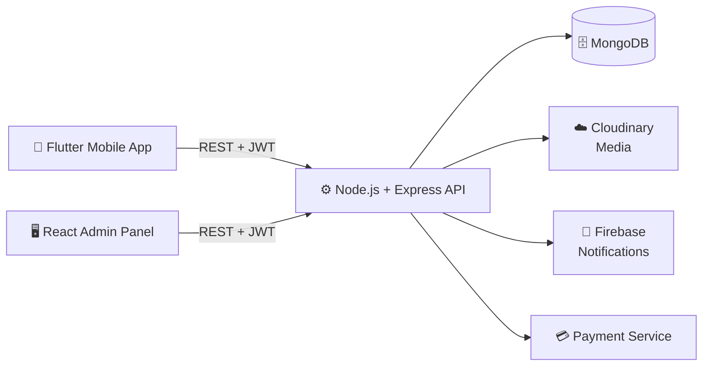
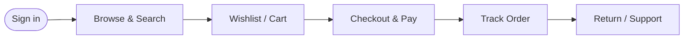

<div align="center">


<a href="https://git.io/typing-svg">

</a>

<br/>


<br/><br/>

**[Overview](#-overview) · [Screenshots](#-screenshots) · [Features](#-features) · [Architecture](#-architecture) · [Getting Started](#-getting-started) · [Roadmap](#-roadmap) · [Author](#-author)**

</div>

---

## 💎 Overview

> *A potli is a traditional drawstring bag, a small treasure carried with pride. Potli reimagines that idea as a premium digital boutique for luxury handbags.*

**Potli** is a complete, production-style e-commerce ecosystem made of three connected parts:

| | Component | What it does |
|:-:|---|---|
| 📱 | **Mobile App** | A polished Flutter shopping experience for Android and iOS |
| ⚙️ | **Backend API** | A secure Node.js + Express REST API backed by MongoDB |
| 🖥️ | **Admin Panel** | A React + Vite dashboard to run the store |

---

## 🖼️ Screenshots

### 📱 Mobile Application

<div align="center">


<p><em>The Potli mobile shopping experience</em></p>

</div>

### 🖥️ Admin Panel

<div align="center">


<p><em>📊 Dashboard Overview</em></p>


<p><em>🗂️ Management Interface</em></p>


<p><em>⚡ Additional Interface</em></p>

</div>

---

## ✨ Features

<details open>
<summary><b>📱 Mobile App (for shoppers)</b></summary>
<br/>

| | Feature | Description |
|:-:|---|---|
| 🔐 | **Authentication** | Secure sign-up, login and account access |
| 👜 | **Product Catalogue** | Browse handbags with rich product details |
| 🔎 | **Search** | Discover products quickly |
| ❤️ | **Wishlist** | Save favourites for later |
| 🛒 | **Shopping Cart** | Add, remove and manage items |
| 💳 | **Checkout** | Smooth checkout and payment workflow |
| 📍 | **Addresses** | Manage multiple delivery addresses |
| 📦 | **Orders** | View order history and details |
| 🚚 | **Order Tracking** | Follow the status of every order |
| 🔔 | **Notifications** | Push notifications via Firebase |
| ↩️ | **Returns** | Return-related workflows |
| 🎧 | **Support** | Customer support features |

</details>

<details open>
<summary><b>🖥️ Admin Panel (for store owners)</b></summary>
<br/>

- 📊 Dashboard and store overview
- 👜 Product management
- 🗂️ Category management
- 📦 Order management
- 👥 Customer management
- 💳 Payment and order status management
- ☁️ Product image management
- 🔐 Protected administrative access

> *Available features depend on the implemented admin modules.*

</details>

<details open>
<summary><b>⚙️ Backend Capabilities</b></summary>
<br/>

- 🔑 JWT-based authentication
- 📦 Product and category APIs
- 🛒 Cart and wishlist APIs
- 📍 Address management APIs
- 📑 Order management APIs
- 💳 Payment service integration
- ☁️ Cloudinary media services
- 🔔 Firebase notification integration
- 🗄️ MongoDB data persistence
- 🛡️ Authorization for protected endpoints

</details>

---

## 🧰 Tech Stack

<div align="center">

| Layer | Technologies |
|:-:|:--|
| **📱 Mobile** |     |
| **⚙️ Backend** |     |
| **🖥️ Admin** |    |
| **☁️ Services** |     |

</div>

---

## 🏗️ Architecture



### 🛍️ Customer Journey



---

## 📂 Project Structure

```text
handbag-luxe-fullstack/
│
├── Potli-Flutter-App-Updated/
│   └── Potli-Flutter-App-Updated/
│       ├── android/
│       ├── ios/
│       ├── assets/
│       │   └── images/
│       │       ├── screenshots/      # mobile screenshots
│       │       └── admin/            # admin panel screenshots
│       ├── lib/                      # Flutter source code
│       └── pubspec.yaml
│
└── Potli-Backend-Updated/
    └── my-ecommerce/
        ├── backend/                  # Node.js + Express API
        ├── admin-panel/              # React + Vite dashboard
        ├── docs/
        └── docker-compose.yml
```

---

## 🚀 Getting Started

### Prerequisites

- Flutter SDK and Dart
- Node.js (LTS) and npm
- MongoDB (local or Atlas), or Docker
- Cloudinary and Firebase projects

### 1️⃣ Clone the repository

```bash
git clone https://github.com/keshavappdev/<your-repo-name>.git
cd handbag-luxe-fullstack
```

### 2️⃣ Run the backend

```bash
cd Potli-Backend-Updated/my-ecommerce/backend
npm install
cp .env.example .env     # then fill in your own values
npm run dev
```

### 3️⃣ Run the admin panel

```bash
cd Potli-Backend-Updated/my-ecommerce/admin-panel
npm install
npm run dev
```

### 4️⃣ Run the mobile app

```bash
cd Potli-Flutter-App-Updated/Potli-Flutter-App-Updated
flutter pub get
flutter run
```

### 🐳 Or start the backend stack with Docker

```bash
cd Potli-Backend-Updated/my-ecommerce
docker-compose up --build
```

### 🔧 Environment variables

Create a `.env` file in the backend folder. The names below are examples, so match them to your project:

```env
PORT=5000
MONGO_URI=your_mongodb_connection_string
JWT_SECRET=your_long_random_secret
CLOUDINARY_CLOUD_NAME=your_cloud_name
CLOUDINARY_API_KEY=your_api_key
CLOUDINARY_API_SECRET=your_api_secret
```

---

## 🔐 Security

- 🚫 Keep API keys, database credentials, JWT secrets and service-account files **out of version control**.
- 🔑 Use **environment variables** for all sensitive configuration.
- 🛡️ Protect administrative endpoints with **server-side authorization**.
- ⚠️ Never publish real production credentials in the repository.

---

## 🗺️ Roadmap

- [x] Authentication and protected routes
- [x] Product catalogue, cart and wishlist
- [x] Orders, tracking and notifications
- [x] Admin dashboard
- [ ] Reviews and ratings
- [ ] Coupons and promotional offers
- [ ] Advanced filters and recommendations
- [ ] Analytics and sales reports
- [ ] Automated tests and CI/CD pipeline

---

## 🤝 Contributing

Ideas and improvements are welcome.

1. Fork the project
2. Create a feature branch: `git checkout -b feature/amazing-idea`
3. Commit your changes: `git commit -m "Add amazing idea"`
4. Push the branch: `git push origin feature/amazing-idea`
5. Open a Pull Request

---

## 👨‍💻 Author

<div align="center">

### Keshav Upadhyay

**Flutter / Mobile Application Developer**

<a href="https://github.com/keshavappdev">

</a>

<br/><br/>

⭐ **If you like this project, give it a star.** ⭐

</div>


