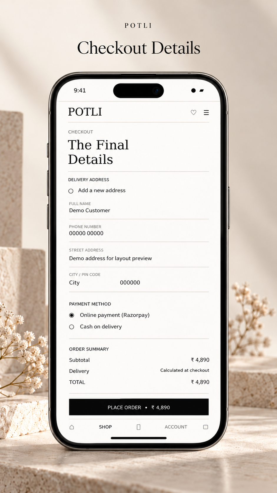
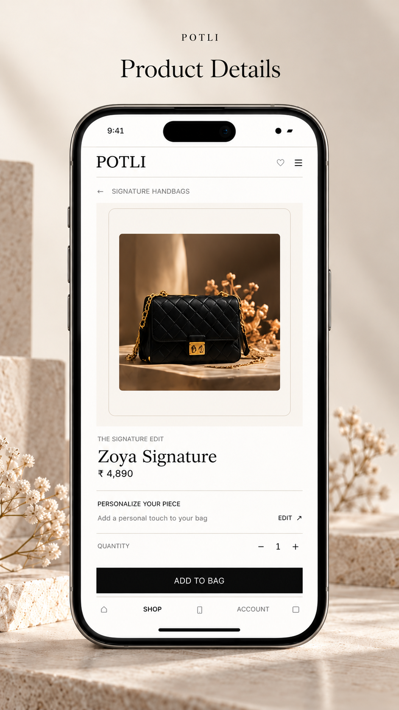
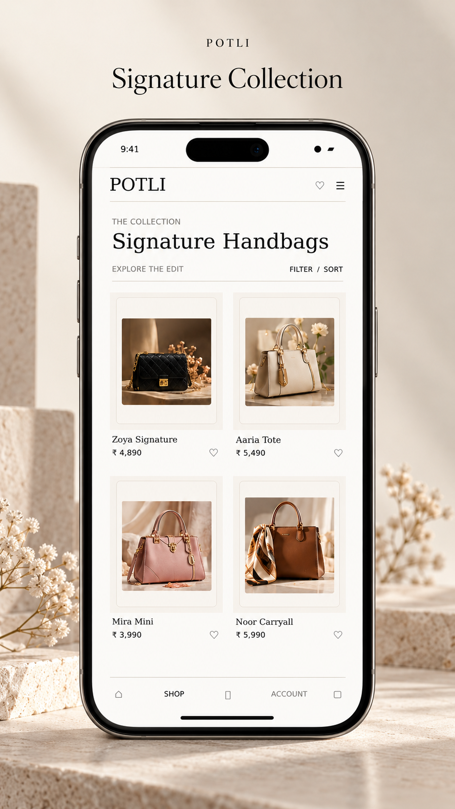
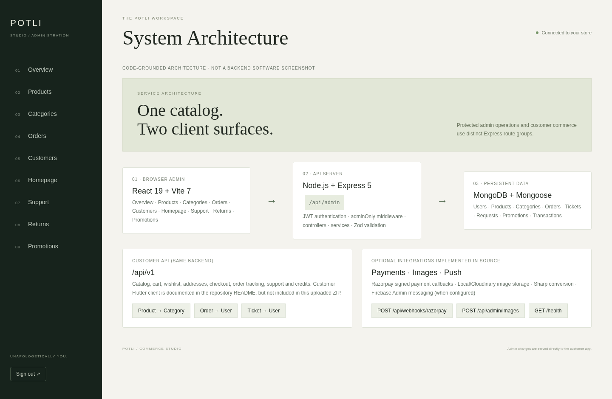
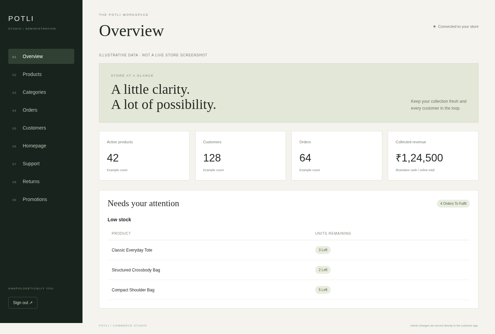
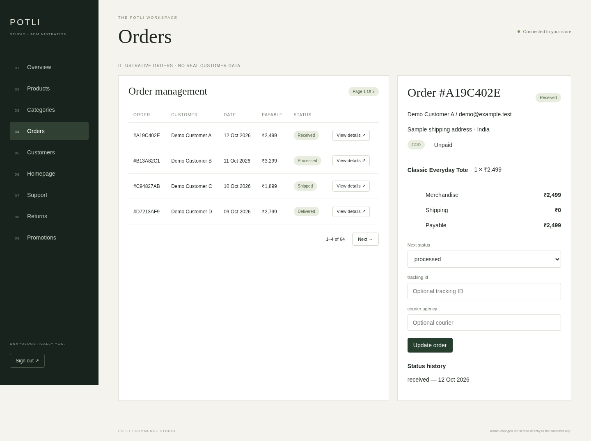
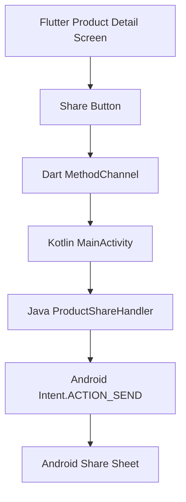
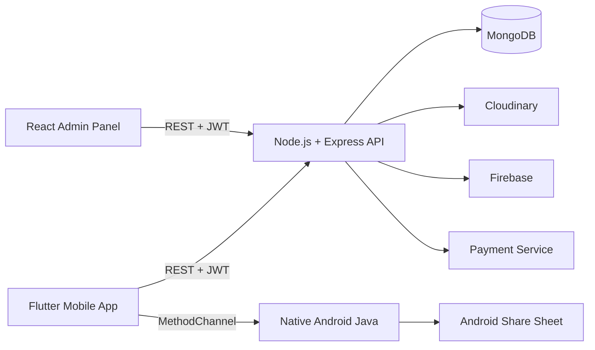
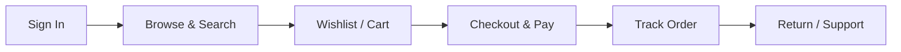

<div align="center">


<a href="https://git.io/typing-svg">

</a>

<br/>


<br/><br/>

**[Overview](#-overview) · [Screenshots](#-screenshots) · [Features](#-features) · [Native Integration](#-android-native-integration) · [Architecture](#-architecture) · [Getting Started](#-getting-started) · [Roadmap](#-roadmap) · [Author](#-author)**

</div>

---

## 💎 Overview

> *A potli is a traditional drawstring bag, a small treasure carried with pride. Potli reimagines that idea as a premium digital boutique for luxury handbags.*

**Potli** is a full-stack e-commerce ecosystem consisting of three connected components.

| | Component | Description |
|:-:|---|---|
| 📱 | **Flutter Mobile App** | Android and iOS shopping experience |
| ⚙️ | **Backend API** | Node.js and Express REST APIs backed by MongoDB |
| 🖥️ | **Admin Panel** | React and Vite dashboard for store management |

The Android application also includes native Java integration through Flutter MethodChannel.

---

## 🖼️ Screenshots

### 📱 Mobile Application

<div align="center">





<p><em>Potli Mobile Shopping Experience</em></p>

</div>

### 🖥️ Admin Panel

<div align="center">



<p><em>Dashboard Overview</em></p>



<p><em>Management Interface</em></p>



<p><em>Additional Admin Interface</em></p>

</div>

---

## ✨ Features

<details open>
<summary><b>📱 Mobile Application</b></summary>

<br/>

| | Feature | Description |
|:-:|---|---|
| 🔐 | Authentication | User registration, login and account management |
| 👜 | Product Catalogue | Browse handbags and view detailed product information |
| 🔎 | Search | Search for available products |
| ❤️ | Wishlist | Save favourite products |
| 🛒 | Shopping Cart | Add, remove and manage cart items |
| 💳 | Checkout | Checkout and payment workflow |
| 📍 | Addresses | Manage delivery addresses |
| 📦 | Orders | View order history and details |
| 🚚 | Order Tracking | Track order status |
| 🔔 | Notifications | Firebase push notifications |
| ↩️ | Returns | Return-related workflows |
| 🎧 | Support | Customer support features |
| 📤 | Native Product Sharing | Share product information through Android's native Share Sheet using Java |

</details>

<details open>
<summary><b>🖥️ Admin Panel</b></summary>

<br/>

- Dashboard and store overview
- Product management
- Category management
- Order management
- Customer management
- Payment and order status management
- Product image management
- Protected administrative access

</details>

<details open>
<summary><b>⚙️ Backend Capabilities</b></summary>

<br/>

- JWT-based authentication
- Product and category REST APIs
- Cart and wishlist APIs
- Address management APIs
- Order management APIs
- Payment service integration
- Cloudinary media services
- Firebase notification integration
- MongoDB data persistence
- Authorization for protected endpoints

</details>

---

## ☕ Android Native Integration

### Product Sharing with Java and Flutter MethodChannel

Potli includes an Android-native product sharing feature implemented using **Java, Kotlin, and Flutter MethodChannel**.

This integration allows customers to share product details using the Android system Share Sheet without requiring an additional Flutter sharing package.

**How it works:**

1. The user opens a product details screen in Flutter.
2. The user taps the Share icon.
3. Flutter sends the product details through a MethodChannel.
4. The Android native layer receives the request.
5. Java uses `Intent.ACTION_SEND` to open the Android Share Sheet.
6. The user selects WhatsApp, Gmail, Bluetooth or another compatible application.

**Technical Implementation**

| Component | Technology |
|---|---|
| Mobile UI | Flutter / Dart |
| Native Android Logic | Java |
| Channel Registration | Kotlin |
| Flutter–Android Communication | MethodChannel |
| Android API | Intent.ACTION_SEND |
| Data Shared | Product name, price and store URL |
| Platform | Android |

### Native Communication Flow



### Implementation Files

```text
android/app/src/main/
├── java/com/potli/app/
│   └── ProductShareHandler.java
└── kotlin/com/potli/app/
    └── MainActivity.kt

lib/
├── services/
│   └── native_product_share_service.dart
└── views/shop/
    └── shop_views.dart
```

**Note:** This integration requires no backend API, database schema or admin panel modifications. Android support is implemented; equivalent native iOS sharing requires a separate Swift implementation.

---

## 🧰 Tech Stack

<div align="center">

| Layer | Technologies |
|:-:|:--|
| **📱 Mobile** | Flutter, Dart, Android, iOS |
| **☕ Native Android** | Java, Kotlin, MethodChannel, Android Intent |
| **⚙️ Backend** | Node.js, Express.js, MongoDB, JWT |
| **🖥️ Admin Panel** | React, Vite, JavaScript |
| **☁️ Services** | Firebase, Cloudinary, Docker, GitHub |

</div>

---

## 🏗️ Architecture



### 🛍️ Customer Journey



---

## 📂 Project Structure

```text
handbag-luxe-fullstack/
│
├── README.md
│
├── Potli-Flutter-App-Updated/
│   └── Potli-Flutter-App-Updated/
│       ├── android/
│       │   └── app/src/main/
│       │       ├── java/com/potli/app/
│       │       │   └── ProductShareHandler.java
│       │       └── kotlin/com/potli/app/
│       │           └── MainActivity.kt
│       ├── ios/
│       ├── assets/
│       │   └── images/
│       ├── lib/
│       │   ├── services/
│       │   │   └── native_product_share_service.dart
│       │   └── views/shop/
│       │       └── shop_views.dart
│       └── pubspec.yaml
│
└── Potli-Backend-Updated/
    └── my-ecommerce/
        ├── backend/
        ├── admin-panel/
        ├── docs/
        └── docker-compose.yml
```

---

## 🚀 Getting Started

### Prerequisites

- Flutter SDK and Dart
- Android SDK and JDK
- Node.js (LTS) and npm
- MongoDB (local or Atlas), or Docker
- Cloudinary and Firebase configuration

### 1️⃣ Clone the Repository

```bash
git clone https://github.com/keshavappdev/handbag-luxe-fullstack.git
cd handbag-luxe-fullstack
```

### 2️⃣ Run the Backend

```bash
cd Potli-Backend-Updated/my-ecommerce/backend
npm install
cp .env.example .env
npm run dev
```

Configure your backend environment variables before starting the API.

### 3️⃣ Run the Admin Panel

From the repository root:

```bash
cd Potli-Backend-Updated/my-ecommerce/admin-panel
npm install
npm run dev
```

### 4️⃣ Run the Flutter Mobile App

From the repository root:

```bash
cd Potli-Flutter-App-Updated/Potli-Flutter-App-Updated
flutter pub get
flutter run
```

### 5️⃣ Test the Java Native Sharing Feature

1. Run the Flutter application on an Android device or emulator.
2. Open the product details screen.
3. Tap the Share icon.
4. Android will display the native sharing interface.
5. Select a compatible application to share the product information.

No additional Flutter package is required for this native integration.

### 🐳 Docker Setup

From the repository root:

```bash
cd Potli-Backend-Updated/my-ecommerce
docker-compose up --build
```

### 🔧 Environment Variables

Create a `.env` file in the backend directory using the actual environment variable names required by the project.

Example:

```env
PORT=5000
MONGO_URI=your_mongodb_connection_string
JWT_SECRET=your_long_random_secret
CLOUDINARY_CLOUD_NAME=your_cloud_name
CLOUDINARY_API_KEY=your_api_key
CLOUDINARY_API_SECRET=your_api_secret
```

---

## 🔐 Security

- Keep database credentials, API keys and JWT secrets out of version control.
- Use environment variables for sensitive backend configuration.
- Protect administrative endpoints using server-side authorization.
- Never publish real production credentials or private keys.
- Review configuration files before pushing the project to GitHub.

---

## 🗺️ Roadmap

- [x] Authentication and protected routes
- [x] Product catalogue, cart and wishlist
- [x] Orders, tracking and notifications
- [x] Admin dashboard
- [x] Android native product sharing using Java and MethodChannel
- [ ] Native iOS product sharing integration
- [ ] Reviews and ratings
- [ ] Coupons and promotional offers
- [ ] Advanced filters and recommendations
- [ ] Analytics and sales reports
- [ ] Automated tests and CI/CD pipeline

---

## 🤝 Contributing

Ideas and improvements are welcome.

1. Fork the repository.
2. Create a feature branch: `git checkout -b feature/amazing-idea`
3. Commit your changes: `git commit -m "Add amazing idea"`
4. Push your branch: `git push origin feature/amazing-idea`
5. Open a Pull Request.

---

## 👨‍💻 Author

<div align="center">

### Keshav Upadhyay

**Flutter / Mobile Application Developer**

<a href="https://github.com/keshavappdev">

</a>

<br/><br/>

⭐ **If you like this project, give it a star!** ⭐

</div>


